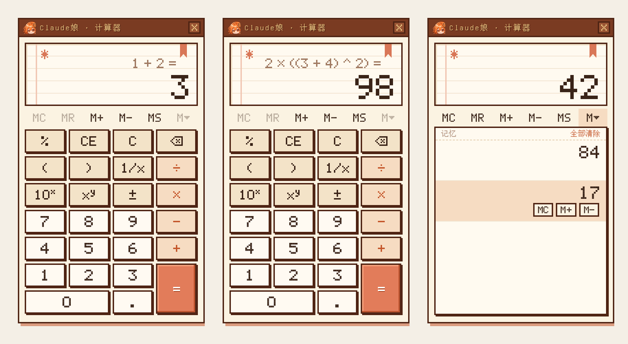

<a id="readme-top"></a>

<div align="center">

**中文** &nbsp;|&nbsp; [English](#english)

</div>

<div align="center">


<br>

**一个住在 claude.ai 角落里的小书童。**<br>
Claude 写字时她翻书，要你点头时她害羞，写完了她叮一声。

<sub>Chrome · Edge &nbsp;·&nbsp; Manifest V3 &nbsp;·&nbsp; 不联网 &nbsp;·&nbsp; 不收集任何数据</sub>

</div>

<br>

## 三分钟装好

> [!TIP]
> 不需要命令行，不需要账号，只要浏览器。

**1 ·** 在 [Releases](https://github.com/Fatima0323/cchan-pixelcompanion/releases) 页面下载最新的 `cchan-pixelcompanion_版本号.zip`（比如 `cchan-pixelcompanion_0.9.0.zip`），解压后得到一个同名文件夹 `cchan-pixelcompanion_版本号`。

**2 ·** 浏览器地址栏打开扩展页面：

| 浏览器 | 地址 |
|:--|:--|
| Chrome | `chrome://extensions` |
| Edge | `edge://extensions` |

**3 ·** 打开右上角的 **开发者模式**，点 **加载已解压的扩展程序**，选中 `cchan-pixelcompanion_版本号` 文件夹（里面直接就是 `manifest.json` 的那一层）。

> [!NOTE]
> 从旧版升级：最简单的是先在扩展页面里**移除**旧版，再加载新版的文件夹，不过这样设置会恢复成默认（浏览器把不同文件夹里的扩展当成两个扩展）。想保留设置的话，把新版文件夹里的所有文件复制进旧版的文件夹、覆盖掉，再在扩展页面点一下她的 **刷新** 按钮。

**4 ·** 刷新 [claude.ai](https://claude.ai)，她会出现在右下角。

> [!NOTE]
> 浏览器规定，网页要先被点过一次才能出声。打开 claude.ai 后随手点一下页面（或者直接发一条消息），之后的提示音就都能正常响了。

<br>

## 她会做什么


她会一直看着页面，根据 Claude 在做什么切换成七种样子：

| | 状态 | 什么时候 | 她在干嘛 |
|:-:|:--|:--|:--|
| 📖 | **待机** | 平时 | 抱着书，轻轻呼吸 |
| ✍️ | **工作中** | Claude 正在输出或运行工具 | 埋头写字；对话框逐字同步最新一句；头顶不断冒出 `token` |
| 🙈 | **需要确认** | 页面出现 允许 / 拒绝 / 继续 之类的按钮，或者 Claude 给了几个选项等你选（只看对话里的；设置页、弹窗、下拉菜单里的选项不算） | 扭扭捏捏地问你；**点她会直接跳到那个按钮 / 选项**——就算你在别的聊天页、别的网站，也会直接把你带回那个等你的聊天页 |
| 💢 | **生气** | 确认按钮挂了 45 秒没人理，或者页面报错 | 抱着手臂跺脚 |
| ✨ | **完成** | 输出结束 | 挥手蹦跳，冒星星，叮～ |
| 🥱 | **犯困** | 闲了 90 秒 | 揉眼睛，晃来晃去 |
| 💤 | **睡觉** | 闲了 3 分钟 | 坐下打盹；你一打字她就醒 |

如果你正在看别的标签页，**完成**和**需要确认**还会弹一条系统通知，点一下就能跳回来。扩展图标上也会挂一个小角标：`…` 工作中 · `!` 等你确认 · `✓` 完成。

> [!TIP]
> **也能陪你用 DeepSeek。** 在设置面板最上面的「陪你盯着」里把 Claude 换成 **DeepSeek**，她就改为盯着 [chat.deepseek.com](https://chat.deepseek.com)：DeepSeek 回答时她进入**工作中**（同样逐字同步、冒 token），答完就**完成**、叮一声；回答变成"服务器繁忙"时她会**生气**。DeepSeek 网页版没有需要你确认的操作，所以这个模式下没有**需要确认**。
>
> 两种模式二选一，默认是 Claude 模式：切到 DeepSeek 后她就不再检测 claude.ai，切回来同理。右键菜单里的跳转、系统通知、在所有网页上显示，都会跟着换成当前选中的那个。

<br>

## 和她互动

**🖱 戳一戳** — 单击她会随机开心或害羞，并说一句话。同一句台词不会连着出现。

**👆 连着戳** — 4 秒内戳 3 下她会慌，戳 5 下她会生气。她在工作、犯困或睡觉的时候被戳，台词也各不相同。

**✋ 拖动** — 按住拖到任何位置，下次打开还在那里。

**📖 右键菜单** — 右键点她，弹出一张小书签菜单（右键不会触发表情）。第一项是「跳到 Claude 聊天页」（DeepSeek 模式下是「跳到 DeepSeek 聊天页」）：
- 还没打开 claude.ai → 帮你新建一个聊天页
- 只开了一个 → 直接跳过去
- 开了好几个 → 展开子菜单让你选，最近用过的排在前面，正在工作 / 等确认的会标出来

菜单第二项是「计算器」（实用的功能总是排在上面，小动画和特效在下面）：在她旁边弹出一个 Claude 娘风格的像素计算器，用法和 Windows 自带的计算器一样，另外多了括号和乘方。



- **按键**：`%` `CE` `C` `⌫` `(` `)` `1/x` `10ˣ`（10 的几次方）`xʸ`（x 的 y 次方：先输入 x，按 `xʸ`，再输入 y，按 `=`）`÷ × − +` `±` `.` `=`，还有一排记忆键 `MC` `MR` `M+` `M−` `MS` `M▾`（`M▾` 打开记忆列表，可以单独调出、加减、删除某一条）
- **先算谁**：按数学规则，括号最先，然后乘方，然后乘除，最后加减，比如 `1 + 2 × 3 =` 是 `7`，`(1 + 2) × 3 =` 是 `9`。左括号键右下角的小数字表示还有几个括号没关上，按 `=` 时没关上的括号会自动补上
- **显示**：上面一行小字是算式（比如 `1 + 2 =`、`2 × (3 + 4)`、`10^(3)`、`2 ^ 10`），下面是大数字；连按 `=` 会重复上一次运算；除以 0 之类会显示「除数不能为零」
- **记住算到哪**：关掉计算器、换个网页，甚至关掉浏览器再打开，下次打开计算器都会回到上一次的样子（比如上次停在 `1 + 2 =` `3`，打开还是它，接着按 `=` 就是 `3 + 2 = 5`）；记忆里存的数也会留着。好几个网页同时开着计算器时，它们是同一个计算器
- **拖动**：按住标题栏拖到哪里都行，下次会出现在同一个地方；点 `×` 关掉，或者再从右键菜单点「收起计算器」
- **键盘**：点一下计算器（边框阴影变成橙色）就可以直接用键盘：数字、`.`、`+ - * /`、`Enter` 或 `=`、`Backspace`（退格）、`Delete`（CE）、`Esc`（C）、`%`、`(` `)`、`^` 或 `Y`（xʸ）、`R`（1/x）、`F9`（±）；`Ctrl+C` / `Ctrl+V` 复制、粘贴数字。这时按键只给计算器，不会跑到网页里；点网页别的地方就还给网页

菜单第三项是「小动画」，让她表演一段：
- **① Claude娘降临** — 嘭一声变成 Claude 的向日葵，使劲挣了三下，花瓣迸开、翻成书页绕着她转；书页冲回来叠成一摞，书壳甩进来夹住，四周的光点旋转着被吸进书里，越来越亮——嘭！她在书的位置现身，站稳后蹦回原位（约 9 秒）
- **② 书页纷飞** — 嘭一声变成一本书，书翻开，书页哗啦啦喷出来把她整个盖住；一阵风吹过，书页四散飘走，她又站在原地了（约 5 秒，有音效，跟着设置里的音量走）

菜单第四项是「特效」，会作用到网页本身：
- **① 黑洞** — 她换成托着黑洞的姿势，被引力微微托离地面、慢慢上下浮着，手心上方浮着一个像素小黑洞（吸积盘旋转、光环、旋臂、被吸进去的粒子、星星）。持续 5 秒：这期间黑洞附近的网页内容会被引力透镜弯曲（越靠近越弯，离得远就恢复原样，靠得很近还能看到翻过来的"爱因斯坦环"），她本人和对话框不受影响；5 秒后一切回到正常。伴有低沉的嗡鸣（跟着设置里的音量走）。透镜用的是 Chromium 的 `backdrop-filter` + SVG 位移滤镜，只在 Chrome / Edge 等 Chromium 浏览器里有扭曲效果

> [!IMPORTANT]
> 她在**等你确认**的时候，点她不会触发表情，而是直接把你带到那个在等你的聊天页；如果你已经在那一页，她会告诉你「已经在这个页面啦」。正事优先。

<br>

## 小细节

<details>
<summary><b>📕 对话框是一本合上的书</b></summary>

<br>

从一端看过去的样子：左边是圆弧书脊，书脊和纸页之间有一道月牙形的暗缝；中间是纸页，切口参差不齐，还有几处小缺口；上下是书皮，比纸页多探出一点。

书皮颜色跟着她的状态变：

| 待机 | 工作中 | 需要确认 / 生气 | 完成 | 犯困 / 睡觉 |
|:-:|:-:|:-:|:-:|:-:|
| 🟫 棕 | 🟧 橙 | 🟥 红 | 🟩 绿 | 🟦 灰蓝 |

对话框是用像素画的，上面的字是普通网页文字，所以依然清晰，也能选中复制。

</details>

<details>
<summary><b>🪙 token 在往上飞</b></summary>

<br>

Claude 每吐出一段字，她头顶就飞出一个像素字 `token`。输出越快冒得越多；Claude 在跑工具、没出字时，也会隔一会儿冒一个。看一眼就知道它是在奋笔疾书还是在埋头查东西。

</details>

<details>
<summary><b>🔔 提示音不会让你听腻</b></summary>

<br>

提示音都由浏览器现场合成，不带音频文件（只有小动画的音效是内置在扩展里的一小段音频）。三类事件各有一组音色，每次随机抽一个，并且**不会连着两次一样**：

| 事件 | 风格 | 音色 |
|:--|:--|:--|
| 完成 | 温暖、有落地感 | 玻璃叮 · 柔和钢琴 · 双音上扬 · 三连琶音 · 卡林巴 |
| 需要确认 | 柔和地叫你一声 | 轻铃 · 微风 · 轻声呼唤（默认）；音乐盒 · 电子叮 · 提醒双音（可在设置里勾选） |
| 开始工作 | 短、轻，音量减半 | 马林巴 · 轻点 |

> 这些是合成出来的近似音色，并不是 Claude 应用里的原始音效。

</details>

<br>

## 设置面板

点浏览器右上角的扩展图标即可打开。

<table>
<tr><td width="30%"><b>基础</b></td><td>开关、<b>陪你盯着</b>（Claude / DeepSeek 二选一）、<b>在所有网页上显示</b>、对话框显示、大小；还能一键<b>演示</b>任意状态，看她的样子</td></tr>
<tr><td><b>声音与通知</b></td><td>音量；三类提示音各自开关；每个音色都能 ▶ 试听，取消勾选就不会被抽到；可以上传自己的完成音</td></tr>
<tr><td><b>形象</b></td><td>给任意状态上传自己的 PNG，替换内置立绘（支持横排多帧动画，白底自动抠掉）</td></tr>
<tr><td><b>高级</b></td><td>各种等待时长、识别规则，以及<b>当前页面的实时检测结果</b></td></tr>
</table>

> [!TIP]
> **逛别的网页时她也在。** 默认在所有网页上都能看到她：Claude 在 claude.ai 那边干活，她就在你正看的网页上跟着冒 token、同步输出；做完了照样叮一声；需要确认时点她一下，直接跳回 claude.ai 那个标签页。不想要的话，在设置里关掉"在所有网页上显示"，她就只待在 claude.ai 上。

> [!TIP]
> 嫌对话框占地方？在设置里关掉"显示对话框"。平时就只剩她自己，但需要你确认时，对话框还是会弹出来。

<details>
<summary><b>⏱ 所有可以调的时间</b></summary>

<br>

| 设置项 | 默认 | 含义 |
|:--|:-:|:--|
| 完成状态保持 | 10 秒 | 叮完之后，开心多久再回到待机 |
| 确认多久没人点就生气 | 45 秒 | 别让她等太久 |
| 出错后生气多久 | 8 秒 | 之后自己消气 |
| 待机多久后犯困 | 90 秒 | |
| 待机多久后睡着 | 3 分钟 | |

</details>

<br>

## 换上你自己的她

设置面板 → **形象**，每个状态一行：

1. 准备一张 PNG（白底或透明底都可以）
2. 在对应状态那一行选择图片
3. 如果是动画，把每一帧**横向排成一条**、每帧等宽，再填上帧数和每秒帧数

没上传的状态继续用内置立绘。星星、zzz、`token` 这些特效会照常叠加在你的图上。点"全部恢复内置立绘"即可还原。

<br>

## 遇到问题

<details>
<summary><b>她没有反应 / 状态不对</b></summary>

<br>

claude.ai（或 DeepSeek）改版后，页面结构可能会变，检测就会失灵。先打开 设置 → **高级**，看"当前页面检测"那几行：

- **正在生成** 一直是"否" → 生成状态没识别到
- **确认按钮** 一直是"无" → 你的界面上，确认按钮的文字可能不在默认规则里

第二种情况，可以在高级里的「"需要确认"按钮文字」一栏加上你看到的按钮文字。比如界面是日语，就加上 `|許可|拒否`。

</details>

<details>
<summary><b>没有声音</b></summary>

<br>

- 先在 claude.ai 页面上随便点一下（浏览器的自动播放限制）
- 检查设置里的声音开关和音量
- 设置 → 高级 里，"声音"那一行显示"已就绪"才说明声音已经解锁

</details>

<details>
<summary><b>想暂时让她消失</b></summary>

<br>

设置面板最上面关掉"启用"即可，再打开时她会回到原来的位置。如果被拖到看不见的地方，点 设置 → 高级 → **把她放回右下角**。

</details>

<br>

## 隐私

她只读取你选中的那个 AI 聊天站（Claude 模式下是 `https://claude.ai/*`，DeepSeek 模式下是 `https://chat.deepseek.com/*`）上的内容来判断 AI 的状态。打开"在所有网页上显示"后，她也会出现在其他网页上，但在那些网页上**只负责显示**，不读取网页内容。

- 不联网，不向任何地方发送数据
- 设置、你上传的图片和音频，都只保存在你自己的浏览器里
- 申请的权限：`storage`（存设置）、`unlimitedStorage`（存你上传的图）、`notifications`（系统通知）；为了在所有网页上显示，安装时浏览器会提示"读取和更改所有网站上的数据"——她在其他网页上只是把自己画出来，不会读写网页内容

<br>

<details>
<summary><b>给想改代码的人</b></summary>

<br>

```
cchan-pixelcompanion_版本号/
├─ manifest.json      扩展清单
├─ content.js         状态检测（Claude / DeepSeek）· 对话框 · 互动 · 台词 · 右键菜单
├─ sprite.js          角色渲染：立绘 + 动作 + 特效 + token
├─ sprite-art.js      内置立绘：七种状态 + 托着黑洞的姿势（已抠图，96 色量化）
├─ book.js            对话框背后那本像素书
├─ sounds.js          提示音合成与不重复随机
├─ anim-logo.js       小动画「Claude娘降临」
├─ anim-logo-art.js   ↑ 用到的花瓣形状和音效
├─ anim-book.js       小动画「书页纷飞」
├─ anim-art.js        ↑ 用到的书本像素图和音效
├─ fx-blackhole.js    特效「黑洞」：黑洞本体 + 引力透镜
├─ calc-core.js       计算器的计算逻辑（照着 Windows 计算器"标准"模式）
├─ calc-ui.js         计算器界面：像素点阵字、按键、记忆列表
├─ calc.js            计算器面板：打开 / 拖动 / 键盘 / 记住上次算到哪
├─ calc-keys.js       计算器的键盘钩子（比网页先拿到按键）
├─ defaults.js        默认设置、支持的 AI 聊天站
├─ background.js      系统通知、图标角标、状态转播、右键菜单的跳转
├─ popup.html / .js   设置面板
├─ icons/             图标
└─ docs/              README 里用的图
```

**改台词**：在 `content.js` 里搜 `LINES`，每种场景是一组句子，往里面加就行。

**改检测规则**：`content.js` 顶部的 `SEL`。

| 判断 | 依据 |
|:--|:--|
| 正在生成 | 存在 `[data-is-streaming="true"]`，或页面上有可见的"停止"按钮 |
| 最新输出 | 最后一个 `[data-is-streaming]` / `.font-claude-response` 元素 |
| 需要确认 | 按钮文字匹配设置里的正则 |
| 出错 | 可见的 `[role="alert"]` 里出现 error / failed / 出错 等字样 |

**DeepSeek 模式**的检测在 `content.js` 的 `SELS.deepseek` 和 `dsWorking()`：输入框为空时，旁边的发送键变成亮着的"停止"键就算在回答；另外最新一条回答（`.ds-markdown`）的字数在连续变化也算。回答里出现"服务器繁忙"算出错。

**改书的样子**：`book.js` 开头的几个常量，分别控制书皮厚度、书脊宽度、书皮探出长度。

</details>

<br>

<div align="center">
<sub>Fatima 提供灵感、细节与指导 · GPT 绘制人设 · Claude 编写 · 献给每一个盯着屏幕等回复的人</sub>
</div>

<br>

---

<br>

<a id="english"></a>

<div align="center">

[中文](#readme-top) &nbsp;|&nbsp; **English**


<br>

**A little study companion who lives in a corner of claude.ai.**<br>
She turns pages while Claude writes, gets shy when Claude needs your OK, and chimes when it's done.

<sub>Chrome · Edge &nbsp;·&nbsp; Manifest V3 &nbsp;·&nbsp; Works offline &nbsp;·&nbsp; Collects no data</sub>

</div>

<br>

## Install in three minutes

> [!TIP]
> No command line, no account — all you need is a browser.

**1 ·** Download the latest `cchan-pixelcompanion_<version>.zip` (for example, `cchan-pixelcompanion_0.9.0.zip`) from the [Releases](https://github.com/Fatima0323/cchan-pixelcompanion/releases) page, and unzip it to get a folder with the same name, `cchan-pixelcompanion_<version>`.

**2 ·** Open the extensions page by typing this into the address bar:

| Browser | Address |
|:--|:--|
| Chrome | `chrome://extensions` |
| Edge | `edge://extensions` |

**3 ·** Turn on **Developer mode** in the top-right corner, click **Load unpacked**, and select the `cchan-pixelcompanion_<version>` folder (the level that directly contains `manifest.json`).

> [!NOTE]
> Upgrading from an older version: the simplest way is to **remove** the old version on the extensions page and then load the new folder, but this resets your settings to the defaults (the browser treats extensions loaded from different folders as different extensions). To keep your settings, copy all the files from the new folder into the old folder, overwriting the old ones, then click her **Reload** button on the extensions page.

**4 ·** Refresh [claude.ai](https://claude.ai). She will appear in the bottom-right corner.

> [!NOTE]
> Browsers don't allow a page to play sound until you have clicked on it at least once. After opening claude.ai, click anywhere on the page (or just send a message), and all notification sounds will work from then on.

<br>

## What she does


She keeps an eye on the page and switches between seven looks depending on what Claude is doing:

| | State | When | What she does |
|:-:|:--|:--|:--|
| 📖 | **Idle** | Most of the time | Hugs her book and breathes softly |
| ✍️ | **Working** | Claude is writing a reply or running a tool | Writes with her head down; the dialog box mirrors the latest sentence word by word, and `token`s keep popping up above her head |
| 🙈 | **Needs confirmation** | A button such as Allow / Deny / Continue appears on the page, or Claude offers a few options for you to choose from (only options inside the conversation count; options on the settings page, in pop-up dialogs, or in drop-down menus are ignored) | Asks you, a little shyly. **Click her to jump straight to that button or option** — even if you are on another chat or another website, she takes you right back to the chat that is waiting for you |
| 💢 | **Angry** | A confirmation button has gone unanswered for 45 seconds, or the page shows an error | Crosses her arms and stamps her feet |
| ✨ | **Done** | Claude has finished its reply | Waves, hops, sparkles, and chimes |
| 🥱 | **Drowsy** | Idle for 90 seconds | Rubs her eyes and sways back and forth |
| 💤 | **Sleeping** | Idle for 3 minutes | Sits down and dozes off; she wakes up as soon as you start typing |

If you are looking at another tab, **Done** and **Needs confirmation** also trigger a system notification — click it to jump back. The extension icon also shows a small badge: `…` working · `!` waiting for your confirmation · `✓` done.

> [!TIP]
> **She can keep you company on DeepSeek, too.** At the top of the settings panel, switch 「陪你盯着」 (Watching) from Claude to **DeepSeek**, and she will watch [chat.deepseek.com](https://chat.deepseek.com) instead: while DeepSeek is answering she is **Working** (mirroring the output word by word and popping out tokens as usual); when the answer is finished she switches to **Done** and chimes; and if the answer turns into "Server busy", she gets **Angry**. The DeepSeek web app has no actions that need your confirmation, so there is no **Needs confirmation** state in this mode.
>
> You can use only one mode at a time, and Claude mode is the default: after switching to DeepSeek she stops watching claude.ai, and vice versa. Jumping to a chat from the right-click menu, system notifications, and "Show on all websites" all follow whichever site is currently selected.

<br>

## Playing with her

**🖱 Poke** — Click her once and she becomes happy or shy at random and says something. The same line never comes up twice in a row.

**👆 Keep poking** — Poke her 3 times within 4 seconds and she panics; poke her 5 times and she gets angry. She also has different lines for being poked while she is working, drowsy, or asleep.

**✋ Drag** — Press and hold to drag her anywhere. She will be in the same spot the next time you open the page.

**📖 Right-click menu** — Right-click her to open a small bookmark-style menu (right-clicking does not trigger an expression). The first item is 「跳到 Claude 聊天页」 (Go to Claude chat), or 「跳到 DeepSeek 聊天页」 (Go to DeepSeek chat) in DeepSeek mode:
- If claude.ai isn't open yet → opens a new chat for you
- If exactly one chat is open → jumps straight to it
- If several chats are open → opens a submenu so you can pick one; the most recently used chats come first, and chats that are working or waiting for confirmation are marked

The second item is 「计算器」 (Calculator). Practical features always come first in the menu, with the mini animations and effects below them. A pixel-art calculator in Claude-chan's style pops up next to her. It works like the built-in Windows Calculator, with parentheses and powers added.


- **Keys**: `%` `CE` `C` `⌫` `(` `)` `1/x` `10ˣ` (10 to the power of x) `xʸ` (x to the power of y: enter x, press `xʸ`, enter y, then press `=`) `÷ × − +` `±` `.` `=`, plus a row of memory keys: `MC` `MR` `M+` `M−` `MS` `M▾` (`M▾` opens the memory list, where you can recall, add to, subtract from, or delete individual entries)
- **Order of operations**: standard math rules apply. Parentheses come first, then powers, then multiplication and division, then addition and subtraction. For example, `1 + 2 × 3 =` gives `7`, and `(1 + 2) × 3 =` gives `9`. The small number at the bottom-right of the left-parenthesis key shows how many parentheses are still open; any that are still open are closed automatically when you press `=`
- **Display**: the small line on top shows the expression (for example, `1 + 2 =`, `2 × (3 + 4)`, `10^(3)`, or `2 ^ 10`), and the big number below shows the value. Pressing `=` again repeats the last operation. Errors such as dividing by zero are shown as 「除数不能为零」 (Cannot divide by zero)
- **Remembers where you left off**: if you close the calculator, switch to another page, or even quit and reopen the browser, the calculator comes back exactly as you left it the next time you open it (for example, if you stopped at `1 + 2 =` `3`, that is what you see, and pressing `=` gives `3 + 2 = 5`). Numbers stored in memory are kept too. If several pages have the calculator open, they all share the same calculator
- **Moving**: drag the title bar to put it anywhere; it reopens in the same spot next time. Click `×` to close it, or choose 「收起计算器」 (Hide calculator) from the right-click menu
- **Keyboard**: click the calculator (its border shadow turns orange) to type on it directly: digits, `.`, `+ - * /`, `Enter` or `=`, `Backspace`, `Delete` (CE), `Esc` (C), `%`, `(` `)`, `^` or `Y` (xʸ), `R` (1/x), and `F9` (±). `Ctrl+C` / `Ctrl+V` copy and paste numbers. While the calculator has focus, your keystrokes go only to it, not to the web page; click anywhere else on the page to give the keyboard back

The third item is 「小动画」 (Mini animations), where she puts on a little show:
- **① Claude娘降临 (Claude-chan Descends)** — *Poof!* She turns into Claude's sunflower logo and strains three times until the petals burst apart and flip into book pages that circle around her. The pages rush back into a stack, the cover swings in to close around them, and the sparks of light around her spiral into the book, glowing brighter and brighter — *poof!* She appears where the book was, steadies herself, and hops back into place (about 9 seconds)
- **② 书页纷飞 (Flying Pages)** — *Poof!* She turns into a book that falls open, and its pages come pouring out until they cover her completely. A gust of wind blows through, the pages scatter and drift away, and there she is again, standing in the same spot (about 5 seconds, with sound effects that follow the volume in Settings)

The fourth item is 「特效」 (Effects), which act on the web page itself:
- **① 黑洞 (Black Hole)** — She switches to a pose holding a black hole: gravity lifts her slightly off the ground and she bobs gently up and down, while a tiny pixel-art black hole floats above her palm (a spinning accretion disk, a glowing ring, spiral arms, particles falling in, and twinkling stars). The effect lasts 5 seconds. During that time, web content near the black hole is bent by gravitational lensing — the closer it is, the stronger the bend; content farther away looks normal, and very close to the hole you can even see a flipped "Einstein ring". She and her dialog box are not distorted. After 5 seconds, everything returns to normal. A low hum plays along (following the volume in Settings). The lens uses Chromium's `backdrop-filter` with an SVG displacement filter, so the distortion only appears in Chromium-based browsers such as Chrome and Edge

> [!IMPORTANT]
> While she is **waiting for your confirmation**, clicking her does not trigger an expression. Instead, she takes you straight to the chat that is waiting for you; if you are already on that page, she tells you so. First things first.

<br>

## Little details

<details>
<summary><b>📕 The dialog box is a closed book</b></summary>

<br>

It shows the book as seen from one end: on the left is the rounded spine, with a crescent-shaped dark gap between the spine and the pages; in the middle are the pages, with an uneven edge and a few small nicks; at the top and bottom are the covers, which stick out a little past the pages.

The cover color changes with her state:

| Idle | Working | Needs confirmation / Angry | Done | Drowsy / Sleeping |
|:-:|:-:|:-:|:-:|:-:|
| 🟫 Brown | 🟧 Orange | 🟥 Red | 🟩 Green | 🟦 Slate blue |

The dialog box is drawn in pixel art, but the text on it is ordinary web text, so it stays sharp and you can still select and copy it.

</details>

<details>
<summary><b>🪙 Tokens float upward</b></summary>

<br>

Every time Claude outputs a chunk of text, a pixel-art `token` flies up from above her head. The faster the output, the more tokens appear. When Claude is running tools and not producing text, one still pops up every so often. One glance tells you whether it is busy writing or busy looking things up.

</details>

<details>
<summary><b>🔔 Notification sounds that don't get old</b></summary>

<br>

Notification sounds are synthesized live by the browser, with no audio files (the only exception is the sound effects for the mini animations, which are short audio clips built into the extension). Each of the three event types has its own set of tones. One is picked at random each time, and **the same tone never plays twice in a row**:

| Event | Style | Tones |
|:--|:--|:--|
| Done | Warm, with a sense of landing | Glass ding · Soft piano · Rising two-note · Three-note arpeggio · Kalimba |
| Needs confirmation | A gentle call | Soft bell · Breeze · Gentle call (default); Music box · Electronic ding · Two-note alert (can be enabled in Settings) |
| Starts working | Short and light, at half volume | Marimba · Light tap |

> These are synthesized approximations, not the original sound effects from the Claude app.

</details>

<br>

## Settings panel

Click the extension icon in the top-right corner of the browser to open it.

<table>
<tr><td width="30%"><b>Basics</b></td><td>On/off switch, <b>Watching</b> (陪你盯着: Claude or DeepSeek, one at a time), <b>Show on all websites</b> (在所有网页上显示), dialog box display, and size. You can also <b>preview</b> any state with one click to see how she looks</td></tr>
<tr><td><b>Sound & notifications</b> (声音与通知)</td><td>Volume and a separate switch for each of the three notification sound types. Every tone can be previewed with ▶; uncheck a tone and it will never be picked. You can also upload your own "done" sound</td></tr>
<tr><td><b>Appearance</b> (形象)</td><td>Upload your own PNG for any state to replace the built-in artwork (horizontal multi-frame animation strips are supported, and white backgrounds are removed automatically)</td></tr>
<tr><td><b>Advanced</b> (高级)</td><td>Wait times, detection rules, and <b>live detection results for the current page</b></td></tr>
</table>

> [!TIP]
> **She comes along when you browse other websites.** By default, she is visible on every website. While Claude is working over on claude.ai, she pops out tokens and mirrors the output on whatever page you are viewing; when it's done, she still chimes; and when something needs your confirmation, one click on her takes you straight back to that claude.ai tab. If you don't want this, turn off "Show on all websites" (在所有网页上显示) in Settings and she will stay on claude.ai only.

> [!TIP]
> Is the dialog box taking up too much space? Turn off "Show dialog box" (显示对话框) in Settings. Most of the time you will only see her, but the dialog box will still pop up when something needs your confirmation.

<details>
<summary><b>⏱ Every adjustable timing</b></summary>

<br>

| Setting | Default | Meaning |
|:--|:-:|:--|
| How long the Done state lasts | 10 seconds | How long she stays happy after the chime before going back to idle |
| How long an unanswered confirmation takes to make her angry | 45 seconds | Don't keep her waiting too long |
| How long she stays angry after an error | 8 seconds | Then she calms down on her own |
| Idle time before she gets drowsy | 90 seconds | |
| Idle time before she falls asleep | 3 minutes | |

</details>

<br>

## Make her your own

Settings panel → **Appearance** (形象), one row per state:

1. Prepare a PNG (a white or transparent background both work)
2. Choose the image in the row for that state
3. For an animation, lay the frames out **in a single horizontal strip**, each frame the same width, then enter the number of frames and the frames per second

Any state you don't upload keeps its built-in artwork. Effects such as stars, zzz, and `token`s are still layered on top of your image. Click "Restore all built-in artwork" (全部恢复内置立绘) to go back to the originals.

<br>

## Troubleshooting

<details>
<summary><b>She doesn't react / shows the wrong state</b></summary>

<br>

When claude.ai (or DeepSeek) is redesigned, its page structure may change and detection can stop working. First open Settings → **Advanced** (高级) and look at the rows under "Current page detection" (当前页面检测):

- **Generating** (正在生成) always shows "No" (否) → the generating state isn't being detected
- **Confirmation button** (确认按钮) always shows "None" (无) → the confirmation buttons in your interface may use text that isn't in the default rules

In the second case, add the button text you see to the 「"需要确认"按钮文字」 ("Needs confirmation" button text) field under Advanced. For example, if your interface is in Japanese, add `|許可|拒否`.

</details>

<details>
<summary><b>No sound</b></summary>

<br>

- First click anywhere on the claude.ai page (this is the browser's autoplay restriction)
- Check the sound switches and the volume in Settings
- Under Settings → Advanced, sound is unlocked only when the "Sound" (声音) row shows "Ready" (已就绪)

</details>

<details>
<summary><b>Want to hide her for a while</b></summary>

<br>

Turn off "Enable" (启用) at the top of the settings panel. When you turn it back on, she returns to where she was. If you dragged her somewhere out of sight, click Settings → Advanced → **Put her back in the bottom-right corner** (把她放回右下角).

</details>

<br>

## Privacy

She only reads content on the AI chat site you have selected (`https://claude.ai/*` in Claude mode, `https://chat.deepseek.com/*` in DeepSeek mode) to figure out what the AI is doing. With "Show on all websites" turned on, she also appears on other websites, but there she **only displays herself** and does not read the page's content.

- No network access; nothing is sent anywhere
- Your settings and any images or audio you upload are stored only in your own browser
- Permissions requested: `storage` (to save settings), `unlimitedStorage` (to store the images you upload), and `notifications` (for system notifications). Because she can appear on all websites, the browser will warn during installation that the extension can "Read and change all your data on all websites" — on other websites she only draws herself and never reads or changes the page's content

<br>

<details>
<summary><b>For anyone who wants to modify the code</b></summary>

<br>

```
cchan-pixelcompanion_<version>/
├─ manifest.json      Extension manifest
├─ content.js         State detection (Claude / DeepSeek) · dialog box · interaction · lines · right-click menu
├─ sprite.js          Character rendering: artwork + motion + effects + tokens
├─ sprite-art.js      Built-in artwork: seven states + the black-hole pose (background removed, quantized to 96 colors)
├─ book.js            The pixel-art book behind the dialog box
├─ sounds.js          Sound synthesis and no-repeat random selection
├─ anim-logo.js       Mini animation "Claude娘降临" (Claude-chan Descends)
├─ anim-logo-art.js   ↑ its petal shapes and sound effect
├─ anim-book.js       Mini animation "书页纷飞" (Flying Pages)
├─ anim-art.js        ↑ its pixel-art book and sound effect
├─ fx-blackhole.js    "Black Hole" effect: the black hole itself + gravitational lensing
├─ calc-core.js       Calculator logic (modeled on the Windows Calculator's Standard mode)
├─ calc-ui.js         Calculator interface: pixel bitmap font, keys, memory list
├─ calc.js            Calculator panel: opening, dragging, keyboard, remembering where you left off
├─ calc-keys.js       Calculator keyboard hook (gets keystrokes before the web page does)
├─ defaults.js        Default settings and the supported AI chat sites
├─ background.js      System notifications, icon badge, state relay, right-click menu jumps
├─ popup.html / .js   Settings panel
├─ icons/             Icons
└─ docs/              Images used in this README
```

**Changing her lines**: Search for `LINES` in `content.js`. Each situation has a list of sentences — just add yours to it.

**Changing the detection rules**: `SEL` at the top of `content.js`.

| Check | Based on |
|:--|:--|
| Generating | `[data-is-streaming="true"]` exists, or a visible "Stop" button is on the page |
| Latest output | The last `[data-is-streaming]` / `.font-claude-response` element |
| Needs confirmation | The button text matches the regular expression in Settings |
| Error | A visible `[role="alert"]` contains words such as error / failed / 出错 |

Detection in **DeepSeek mode** lives in `SELS.deepseek` and `dsWorking()` in `content.js`: when the input box is empty and the send button next to it has turned into an active "Stop" button, DeepSeek counts as answering; the latest answer (`.ds-markdown`) changing length several times in a row also counts. An answer that contains "服务器繁忙" (server busy) counts as an error.

**Changing how the book looks**: The constants at the start of `book.js` control the cover thickness, the spine width, and how far the covers stick out.

</details>

<br>

<div align="center">
<sub>Inspiration, details, and direction by Fatima · Character design drawn by GPT · Written by Claude · For everyone who has ever stared at a screen waiting for a reply</sub>
</div>
